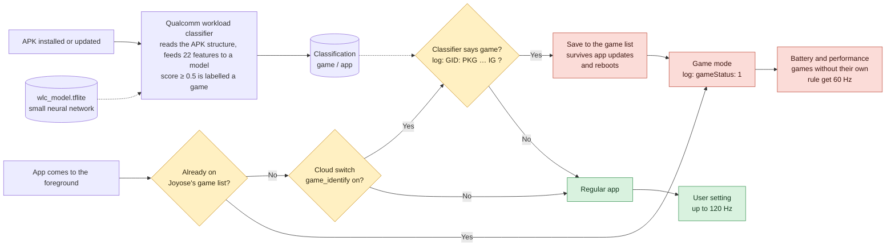

# Joyose, where's my 120 Hz?

*[繁體中文](README.zh-TW.md)*

The map app I develop was suddenly capped at 60 Hz on Xiaomi phones, although
earlier versions ran at 120 Hz. It turned out the app had been classified as a
"game" and locked to 60 Hz. By decompiling the system packages involved, we
worked out how HyperOS decides what to do when an app comes to the foreground.



The key is the **game list** box. Once an app is classified as a game, the
result is saved, and every later time it comes to the foreground the saved
result is used without asking the classifier again. So even after you shrink
your APK, the old record has to be cleared before the change takes effect.

The core fix is to make the Qualcomm workload classifier's neural network stop
scoring the app as a game, and to clear the data of a few system apps so they
stop returning the cached result.

The mechanism does make sense: it reduces heat and stutter in games. But it is
better to have a way out and not need it than to need one and not have it, so
here is the full solution.

## Joyose

`com.xiaomi.joyose` is a preinstalled Xiaomi system app that manages game
performance and power, much like Samsung's Game Optimizing Service. It
downloads its rules from Xiaomi's servers, decides whether the foreground app
is a game, and turns on game mode for games.

Three system components are involved:

| Component | Package | Role |
|---|---|---|
| Qualcomm workload classifier | `com.qualcomm.qti.workloadclassifier` | Scans every APK once when it is installed or updated and labels it app, game, browser, video… |
| Joyose | `com.xiaomi.joyose` | Decides whether the app coming to the foreground is a game. When its cloud switch `game_identify` is on, it asks the Qualcomm classifier. **Apps it decides are games are saved to disk.** |
| Battery and performance | `com.miui.powerkeeper` | Sets the refresh rate per app. Games without a specific rule always get **60 Hz**. |

### How an app becomes a "game"

1. On install, the Qualcomm classifier reads the APK and feeds 22 features into
   a small neural network (`/system_ext/etc/perf/wlc_model.tflite`). An output
   of 0.5 or more means game.
2. When the app opens, Joyose asks the classifier. If the answer is game, it
   adds the package to its saved game list and tells Battery and performance.
3. While the app is in the foreground, Battery and performance sets
   `miui_refresh_rate` to 60.

### What the classifier looks at

The features are almost all about the APK's **structure**. Neither the name
nor the runtime behaviour matters:

- total APK size
- number of activities
- number and size of files in `assets/`, `res/` and `lib/`, and their ratios
- native libraries of known game engines (Unity, Unreal, Cocos, Godot, libGDX…)
- a few manifest declarations (OpenGL ES version, gamepad, multitouch, `appCategory="game"`)

Single-activity apps that draw their whole UI themselves (Flutter, OpenGL, map
or drawing apps) already look like games: one activity, an almost empty
`res/`, large native libraries. For these apps **`assets/` decides the
result**. For our app:

| `assets/` | Score | Result |
|---|---|---|
| 1146 MB (offline data inside the APK) | 0.9999 | game |
| 17.4 MB | 0.90 | game |
| 10 MB | 0.66 | game |
| 9 MB | 0.44 | not a game |
| 7 MB | 0.24 | not a game |
| 2.8 MB | 0.13 | not a game |

What did **not** help: renaming the package, declaring
`android:appCategory="maps"`, switching the map to `TextureView`, removing
foreground services, or adding activities (more activities scored *higher*).

## Check your app

Open your app, then:

```sh
# The last block (mVotesByDisplay) is the vote in effect right now
adb shell dumpsys display | grep -E "PRIORITY_MIUI_REFRESH_RATE|PRIORITY_THERMAL"
```

`PRIORITY_MIUI_REFRESH_RATE … mMaxRefreshRate=60.0` in the last block means
Xiaomi is capping it. (`PRIORITY_THERMAL_LIMIT_REFRESH_RATE` is overheating,
which is a different problem.)

To see who decided it:

```sh
adb logcat -c
# open your app and wait five seconds
adb shell "logcat -d | grep -iE 'GID|gameStatus|miui_refresh_rate'"
```

| Log | Meaning |
|---|---|
| `GID: PKG: your.package IG ? true` | Joyose asked the Qualcomm classifier and the answer was game |
| `GID: PKG: your.package IG ? false` | The classifier says it is not a game |
| No `GID` line for your package, but `gameStatus: 1` | Your app is already on a saved game list |
| `miui_refresh_rate,value:60,pkg:com.miui.powerkeeper` | Battery and performance capped it at 60 |

## Score your APK

The model belongs to Qualcomm and is **not** included here. Pull it from your
own phone, which also makes sure you test the version your phone uses:

```sh
adb pull /system_ext/etc/perf/wlc_model.tflite
pip install ai-edge-litert numpy
python wlc_score.py your-app.apk --model wlc_model.tflite --activities 1 --sweep
```

```
assets/ 17.42 MB, total 57.23 MB
score 0.900 -> GAME
  if assets/ were  10 MB: 0.660
  if assets/ were   7 MB: 0.240
```

`wlc_features.py` needs no model and prints the raw features.
`--activities` is the number of `<activity>` entries in your merged manifest.

## For developers

- **Keep `assets/` in the APK small.** For a single-activity app, aim for a few
  MB, and download large data (maps, models, media) after install. The
  classifier only reads the APK; files your app downloads into its data
  directory do not count.
- **Check every APK you ship**, including builds used to "prepare data". If
  any version is classified as a game, Joyose saves it, and updating to a
  smaller APK does not remove it. Only a full uninstall does.
- Add a size check to your build so `assets/` cannot quietly grow again.

## Users whose app is already on the list

Updating the app is not enough: Joyose's saved list survives updates and
reboots. Either uninstall and reinstall the app (its data is lost), or clear
Joyose and Battery and performance. Xiaomi does not allow `pm clear` on these
two packages, so:

```sh
adb shell pm uninstall --user 0 com.xiaomi.joyose      # removes it together with its data
adb shell cmd package install-existing com.xiaomi.joyose
```

Then clear Battery and performance (Settings → Apps → show system apps →
Battery and performance → Storage → Clear data; or enable *USB debugging
(Security settings)* in developer options and run
`adb shell pm clear com.miui.powerkeeper`), and reboot.

Disabling Joyose also lifts the cap, but real games lose Xiaomi's performance
tuning too.

## Notes

- Everything here was observed on one phone. Xiaomi changes these components
  through cloud updates; if you see different results, please open an issue
  with your model, HyperOS version and logs.
- This repository only describes behaviour and ships its own tools. It does not
  contain Xiaomi's or Qualcomm's code or model files.
