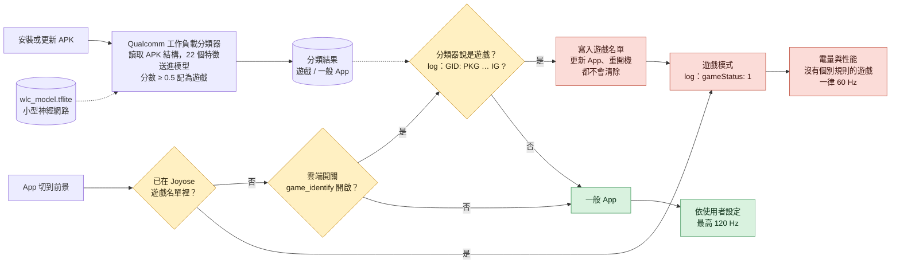

# Joyose, where's my 120 Hz?

*[English](README.md)*

我開發的地圖APP在小米手機上突然被限制在60Hz，在前幾個版本都能正常觸發120Hz。經檢測APP被認定為"Game"並鎖定在60Hz，經過對套件反編譯，我們得到了HyperOS在軟體進入前台時的判斷流程。




重點是**遊戲名單**那一格，App 一旦被判成遊戲，就會被存起來，之後每次切到前景都直接讀取已儲存的結果，不會再問分類器。所以就算之後把 APK 改小，也要先把舊紀錄清掉才會生效。

核心解法是讓Qualcomm 工作負載分類器的神經網路不再判定軟體為遊戲，並且需要清空幾個系統應用的資料阻止取得過往結果的暫存。

這項機制確實有其合理性，減少了發熱以及卡頓，但秉持著可以不用不能沒有的精神，以下是詳細解決方案。

## Joyose

`com.xiaomi.joyose` 是小米手機內建的系統 App，負責遊戲的效能與功耗控制，
角色類似三星的 Game Optimizing Service。它從小米伺服器下載規則，
判斷前景的 App 是不是遊戲，並為遊戲開啟遊戲模式。

牽涉到三個系統元件：

| 元件 | 套件 | 角色 |
|---|---|---|
| Qualcomm 工作負載分類器 | `com.qualcomm.qti.workloadclassifier` | 每個 APK 安裝或更新時掃描一次，標記為一般 App、遊戲、瀏覽器、影片… |
| Joyose | `com.xiaomi.joyose` | App 切到前景時判斷是不是遊戲。雲端開關 `game_identify` 開啟時會去問 Qualcomm 分類器。**判定為遊戲的 App 會存到磁碟上。** |
| 電量與性能 | `com.miui.powerkeeper` | 依 App 設定更新率。沒有個別規則的遊戲一律 **60 Hz**。 |

### 一個 App 怎麼變成「遊戲」

1. 安裝時，Qualcomm 分類器讀取 APK，把 22 個特徵送進一個小型神經網路
   （`/system_ext/etc/perf/wlc_model.tflite`），輸出 0.5 以上就是遊戲。
2. App 打開時，Joyose 去問分類器。答案是遊戲，就把套件加進它存起來的遊戲名單，並通知電量與性能。
3. 電量與性能在這個 App 位於前景時，把 `miui_refresh_rate` 設成 60。


### 分類器看什麼

特徵幾乎都跟 APK 的**結構**有關，不看名稱，也不看執行時的行為：

- APK 總大小
- Activity 數量
- `assets/`、`res/`、`lib/` 的檔案數量、大小，以及彼此的比例
- 已知遊戲引擎的原生函式庫（Unity、Unreal、Cocos、Godot、libGDX…）
- 少數 Manifest 宣告（OpenGL ES 版本、手把、多點觸控、`appCategory="game"`）

自己繪製整個介面的單一 Activity App（Flutter、OpenGL、地圖、繪圖 App）本來就很像遊戲：
只有一個 Activity、`res/` 幾乎是空的、原生函式庫很大。對這類 App 來說，
**決定結果的是 `assets/`**。以我們的 App 為例：

| `assets/` | 分數 | 結果 |
|---|---|---|
| 1146 MB（離線資料放在 APK 裡） | 0.9999 | 遊戲 |
| 17.4 MB | 0.90 | 遊戲 |
| 10 MB | 0.66 | 遊戲 |
| 9 MB | 0.44 | 不是遊戲 |
| 7 MB | 0.24 | 不是遊戲 |
| 2.8 MB | 0.13 | 不是遊戲 |

**沒有用**的作法：改套件名稱、宣告 `android:appCategory="maps"`、把地圖改成
`TextureView`、拿掉前景服務、增加 Activity（Activity 越多分數反而越高）。

## 檢查你的APP情況

打開你的 App，然後：

```sh
# 最後一組（mVotesByDisplay）是目前生效的投票
adb shell dumpsys display | grep -E "PRIORITY_MIUI_REFRESH_RATE|PRIORITY_THERMAL"
```

最後一組出現 `PRIORITY_MIUI_REFRESH_RATE … mMaxRefreshRate=60.0`，就是小米在限制。
（`PRIORITY_THERMAL_LIMIT_REFRESH_RATE` 是過熱，那是另一個問題。）

看是誰決定的：

```sh
adb logcat -c
# 打開你的 App，等 5 秒
adb shell "logcat -d | grep -iE 'GID|gameStatus|miui_refresh_rate'"
```

| Log | 意思 |
|---|---|
| `GID: PKG: 你的套件 IG ? true` | Joyose 問了 Qualcomm 分類器，答案是遊戲 |
| `GID: PKG: 你的套件 IG ? false` | 分類器認為不是遊戲 |
| 沒有你的套件的 `GID`，但有 `gameStatus: 1` | 你的 App 已經在存起來的遊戲名單裡 |
| `miui_refresh_rate,value:60,pkg:com.miui.powerkeeper` | 電量與性能把它鎖在 60 |

## 幫你的 APK 打分數

模型是 Qualcomm 的，**這裡不附**。從你自己的手機拉出來，也能確保測的是你手機上的版本：

```sh
adb pull /system_ext/etc/perf/wlc_model.tflite
pip install ai-edge-litert numpy
python wlc_score.py your-app.apk --model wlc_model.tflite --activities 1 --sweep
```

```
assets/ 17.42 MB, total 57.23 MB
score 0.900 -> GAME
  if assets/ were  10 MB: 0.660
  if assets/ were   7 MB: 0.240
```

`wlc_features.py` 不需要模型，只輸出原始特徵。
`--activities` 是合併後 Manifest 裡 `<activity>` 的數量。

## 給開發者

- **讓 APK 裡的 `assets/` 保持很小**。單一 Activity 的 App 抓幾 MB 就好，
  大型資料（地圖、模型、影音）改成安裝後下載。分類器只讀 APK，
  App 下載到資料區的檔案不算在內。
- **每個發出去的 APK 都要檢查**，包括用來「準備資料」的版本。只要有一個版本被判成遊戲，
  Joyose 就會存起來，之後更新成較小的 APK 也不會移除，只有完全解除安裝才會。
- 在建置流程加上大小檢查，避免 `assets/` 不知不覺又變大。

## 已經被列入名單的使用者

只更新 App 不夠，Joyose 存的名單在更新、重開機後都還在。可以解除安裝再重裝 App
（App 資料會消失），或清除 Joyose 和電量與性能。小米不允許對這兩個套件用 `pm clear`，所以：

```sh
adb shell pm uninstall --user 0 com.xiaomi.joyose      # 連同資料一起移除
adb shell cmd package install-existing com.xiaomi.joyose
```

再清除電量與性能（設定 → 應用程式 → 顯示系統程式 → 電量與性能 → 儲存空間 → 清除資料；
或在開發者選項打開「USB 偵錯（安全性設定）」後執行 `adb shell pm clear com.miui.powerkeeper`），
然後重開機。

停用 Joyose 也能解除限制，但真正的遊戲也會失去小米的效能調校。

## 備註

- 以上都是在一支手機上觀察到的。小米會透過雲端更新改變這些元件的行為；
  如果你看到不一樣的結果，歡迎開 issue，附上機型、HyperOS 版本和 log。
- 這個儲存庫只描述行為，工具是自己寫的，不包含小米或 Qualcomm 的程式碼與模型檔。